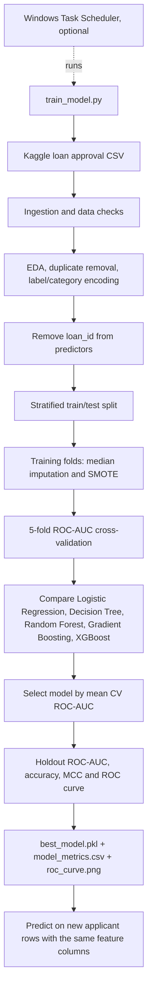

# Loan Approval Prediction

## Project scope

This project predicts whether an application is labelled **Approved (1)** or
**Rejected (0)**. It is a loan-approval classification project, not a loan
default-risk project: the Kaggle data in this workspace contains no later
repayment/default outcome.

The project uses `data/loan_approval_dataset.csv` (4,269 rows, 13 columns).
This is not ProjectPro's `LoansTrainingSetV2.csv`/`CSVtest_data.csv`, so results
and fields cannot be expected to match that paid course exactly.

## Project workflow



## Run

Install the packages listed in `requirements.txt`, then run from this folder:

```powershell
python train_model.py
```

The training script reads the raw Kaggle CSV, removes exact duplicate rows,
encodes its known text labels, excludes `loan_id`, makes a stratified holdout
split, compares five classifiers, and writes:

- `best_model.pkl` — the model selected using mean training-fold ROC-AUC
- `model_metrics.csv` — cross-validation ROC-AUC and holdout accuracy, ROC-AUC,
  and Matthews correlation coefficient (MCC)
- `roc_curve.png` — ROC curves evaluated on the untouched holdout set

SMOTE is inside an imbalanced-learn pipeline, so synthetic examples are
generated only within training folds / training data and never in the holdout
test set. Missing numeric values are median-imputed inside that same pipeline.
The dataset currently has no missing values or exact duplicates.

`data/loan_approval_dataset_balanced.csv` is a legacy export from the earlier
notebook workflow. It is not used by the current training script; use the raw
CSV so train/test separation and fold-local SMOTE remain controlled.

IQR checks flag a small number of high asset values. These are not dropped
automatically: in financial data, an unusually large value is not proof of a
bad record. Check such values against a reliable source before excluding them.
Logistic Regression is scaled; tree-based models do not require feature scaling.

## Prediction

Load the saved pipeline and pass the same feature columns used during training
(all model columns except `loan_id` and `loan_status`):

```python
import pickle
import pandas as pd

with open("best_model.pkl", "rb") as model_file:
    model = pickle.load(model_file)

applicants = pd.read_csv("new_applicants.csv")
applicants.columns = applicants.columns.str.strip().str.lower().str.replace(" ", "_")
features = applicants.drop(columns=["loan_id", "loan_status"], errors="ignore")
category_maps = {
    "education": {"graduate": 1, "not graduate": 0},
    "self_employed": {"yes": 1, "no": 0},
}
for column, mapping in category_maps.items():
    if column in features and not pd.api.types.is_numeric_dtype(features[column]):
        values = features[column].astype("string").str.strip().str.casefold()
        features[column] = values.map(mapping)
        if features[column].isna().any():
            raise ValueError(f"Unknown category value in {column}")
predictions = model.predict(features)
print(predictions)
```

`1` means Approved and `0` means Rejected. Only load pickle files you trust.
The prediction input must include the training features (except the ID and
target), in the training column names; production callers should validate that
schema before prediction.

## Streamlit web app

Install the project dependencies, including Streamlit:

```powershell
python -m pip install -r requirements.txt
```

Run the UI from the project folder:

```powershell
python -m streamlit run app.py
```

The app first looks for `loan_prediction_model.pkl` beside `app.py`. If that
file is absent, it clearly reports that it is using the project's existing
`best_model.pkl`. To load a model stored elsewhere, set `LOAN_MODEL_PATH` to
its full path before starting Streamlit. The input form encodes education and
self-employment using the same mappings as training and orders the inputs
according to the saved model's feature names.

## Optional Windows Task Scheduler retraining

The project does not register a scheduled task automatically. To run retraining
on a cadence you choose, create a task in Windows Task Scheduler:

1. Set the trigger to the interval approved for your use case.
2. Set **Program/script** to the full path of the Python interpreter in the
   environment where the project dependencies are installed.
3. Set **Add arguments** to
   `train_model.py --data "D:\Loan Default Risk Analysis\data\loan_approval_dataset.csv"`.
4. Set **Start in** to `D:\Loan Default Risk Analysis`.

The current CSV is a static Kaggle snapshot, so scheduling it will retrain on
the same data until you provide an updated dataset. A real retraining pipeline
should validate and version newly collected data before replacing the model.
